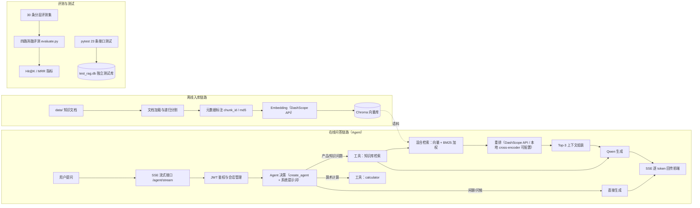

# 扫地机器人 RAG 智能问答系统

## 项目介绍

基于 LangChain + FastAPI 构建的多用户检索增强问答（RAG）应用：扫地机器人产品文档 → 混合检索 + 重排 → LLM 流式问答。回答基于真实产品文档检索生成，可溯源，抑制大模型幻觉。

核心亮点：

- **检索链路完整**：向量检索 + BM25 混合（RRF 加权）→ cross-encoder 重排 → Top-3 精排上下文
- **评测驱动调优**：自建 30 条分层评测集（3 档难度 × 5 类题型），四路消融实验量化每一层的收益
- **工程质量**：冷启动秒级可用（后台线程预热模型 + `/health` / `/ready` 双探针）、SSE 流式输出、全局异常体系、JWT 多用户数据隔离、水平越权防护
- **测试守护**：23 条 pytest 接口测试，测试库与生产库完全隔离，覆盖正常 / 异常 / 越权路径

## 技术栈

| 层 | 选型 |
|---|---|
| Web 框架 | FastAPI + Uvicorn |
| Agent 框架 | LangChain create_agent（工具路由自动决策） |
| RAG 检索 | LangChain（EnsembleRetriever / ContextualCompressionRetriever） |
| 向量存储 | Chroma（本地嵌入式；同类：FAISS 本地型 / Milvus 服务型） |
| Embedding | Qwen text-embedding（DashScope API 型；同类：BGE 本地推理型） |
| 重排 | DashScope rerank API（默认）/ bge-reranker-v2-m3 本地 cross-encoder（配置切换） |
| LLM | Qwen（OpenAI 兼容接口） |
| 数据库 | SQLite + SQLAlchemy ORM |
| 认证 | JWT（OAuth2PasswordBearer + bcrypt） |
| 测试 | pytest + TestClient（dependency_overrides 隔离测试库） |
| 前端 | 原生 HTML / JS / CSS（SSE 流式渲染） |

## 系统架构



## 项目结构

```text
ragProject/
├── backend
│   ├── agent             # Agent：create_agent + 工具（知识库检索 / 计算器）
│   ├── factory           # 模型工厂：LLM / Embedding / 重排器统一出口
│   ├── api/router        # 路由层：auth / session / message / agent / document / health
│   ├── auth              # JWT 认证：签发、校验、依赖注入
│   ├── conversation      # 会话与消息：models / repository / service / database
│   ├── rag               # RAG 核心：检索、重排、入库、评测、文档加载
│   ├── schemas           # Pydantic 请求/响应模型
│   ├── core              # 全局异常体系（BusinessError / NotFoundError）
│   ├── config            # 配置与日志（路径统一 __file__ 锚定）
│   ├── prompt            # 系统提示词模板
│   ├── data              # 知识库语料（产品文档）
│   ├── tests             # pytest 测试（conftest 夹具体系）
│   ├── utils             # 工具：文件处理 / 路径锚定 / prompt 加载
│   └── main.py           # 入口：lifespan 建表 + 模型预热线程
└── frontend              # 原生 JS 前端（登录 / 会话 / SSE 流式渲染）
```

## 量化成果

### 检索评测（30 条评测集，终态链路）

| 检索策略 | Hit@1 | Hit@3 | MRR | 定位 |
|---|---|---|---|---|
| 纯向量 | 67% | 80% | 0.717 | 语义匹配底座 |
| 纯 BM25 | 30% | 50% | 0.403 | 关键词召回弱 |
| 混合（向量 0.6 / BM25 0.4） | 60% | 73% | 0.684 | 负责召回——不漏 |
| 混合 + 重排（最终方案） | **63%** | **87%** | **0.744** | 负责精度——排准 |

消融结论：**混合负责不漏（召回），重排负责排准（精度）**。重排将 Hit@3 从 73% 拉至 87%，Top-3 即可支撑高质量上下文，无需堆 token。

### 调优过程

1. 初版 10 条评测集发现 BM25 权重过高 → 权重调整为 向量 0.6 / BM25 0.4，Hit@1 60% → 80%
2. top_n 消融：重排后取 3 与取 5 无显著差异 → 确认 3（重排已保证精度，堆上下文无收益）
3. 评测集扩至 30 条（加入同义表达、口语、困难题）→ 同义表达 4/6 成为已知短板，下一步方向：query 改写

### 分题型表现（最终链路）

| 题型 | 命中 | 备注 |
|---|---|---|
| 关键词明显 | 10/10 | |
| 口语表达 | 6/6 | |
| 关键词不明显 | 4/5 | |
| 同义表达 | 4/6 | 已知短板，规划 query 改写优化 |
| 多 chunk 相关 | 2/3 | |

### 工程指标

- 接口测试 23/23 通过：auth 6 / session 8 / message 6 / document_loader 2 / health 1
- 冷启动：进程启动秒级可用（会话/历史接口立即可答），模型预热（约 20s）后台线程完成，`/ready` 就绪前前端自动禁用提问按钮
- 知识库 7 份产品文档 → 372 个 chunk，带 chunk_id / md5 / 文件出处元数据

## 快速启动

```bash
# 1. 安装依赖
cd backend
pip install -r requirements.txt

# 2. 配置密钥：复制 backend/.env.example 为 backend/.env，填入 DASHSCOPE_API_KEY 与 SECRET_KEY

# 3. 启动服务（必须在 backend 目录下启动，它是模块运行根）
uvicorn main:app --reload

# 4. 浏览器打开 frontend/index.html，注册账号

# 5. 点击「扫描知识库」完成文档向量化入库，等待「模型加载」提示消失即可提问

# 6. 运行测试（自动使用独立测试库 test_rag.db，不碰生产数据）
pytest
```

## 踩坑记录

- **一个 yield 让整个接口静默失效**：路由函数体内直接写 `yield` 做 SSE，函数变成生成器，FastAPI 只返回生成器对象、函数体一行都不执行。修法：`yield` 收进内部 `event_generator` 函数，路由函数本身保持普通函数。
- **空向量库 = 服务永远 503**：BM25 索引在启动时从 Chroma 全量构建，空库直接 `ValueError`，且崩在后台预热线程里——服务看着活着，`/ready` 永远 503，前端永远「模型加载中」。教训：初始化存在数据依赖时，要么保护空态，要么固化「入库 → 重启 → 就绪」的操作顺序。
- **三种路径锚定，搬一次家全炸**：`import` 锚定运行根（sys.path）、`sqlite:///./` 锚定 CWD、`__file__` 数 parent 锚定文件自身——项目目录重构后三类路径全部移位。修法：统一用 `__file__` 锚定并收敛到工具函数，数据库/日志路径与启动目录彻底解耦。
- **schema 422 与业务 400 双重校验打架**：Pydantic 的 min_length 先执行永远赢，service 层校验沦为死代码，同一个密码规则出现两个阈值。教训：schema 只管格式，业务规则归 service，阈值只定义一次。
